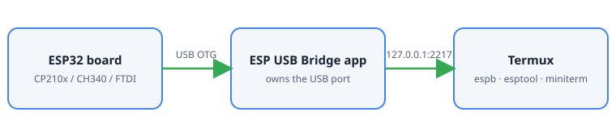

<div align="center">

# ESP USB Bridge

**Flash and monitor an ESP32 from Termux. No root, no PC.**

A small Android app owns the USB port and shares it with Termux as a standard serial-over-network port, so `esptool` and a serial monitor just work from the command line.

[](https://github.com/CodeVortax/esp-usb-bridge/actions/workflows/build-apk.yml)
[](CHANGELOG.md)
[](LICENSE)
[](#install)
[](#use)
[](#privacy)

**English** · [العربية](README.ar.md)

[Why](#why) · [Install](#install) · [Use](#use) · [How it works](#how-it-works) · [Troubleshooting](#troubleshooting) · [Documentation](#documentation) · [Contributing](CONTRIBUTING.md) · [Changelog](CHANGELOG.md)

</div>

---

<p align="center"></p>

## Why

Android does not let Termux open USB devices, and without root there is no `/dev/ttyUSB0`. This app fixes that from the other side: it is allowed to use the USB port, so it does, and it serves the port to Termux on `127.0.0.1:2217` using **RFC 2217**, a standard that `esptool` and `pySerial` already understand. Automatic reset into the bootloader, baud-rate changes and the serial monitor all work.

## Features

| | |
|---|---|
| **Real flashing** | `esptool` over the bridge: automatic bootloader reset (DTR/RTS), speeds up to 921600. |
| **`espb` command** | `start`, `status`, `flash`, `erase`, `info`, `mac`, `monitor`, `log`, `doctor`. |
| **Starts itself** | `espb flash` opens the app and starts the bridge if it is not running. |
| **Scriptable logs** | `espb log --seconds 20 --out boot.log --reset` prints timestamped lines and exits. |
| **Many chips** | CP210x, CH340/CH34x, FTDI, PL2303 and the ESP32's built-in USB, through [usb-serial-for-android](https://github.com/mik3y/usb-serial-for-android). |
| **Local only** | The port listens on `127.0.0.1`, so nothing else on your network can reach the board. |
| **Tested protocol** | CI runs the protocol against a real pySerial RFC 2217 client on every push. |

## Install

**1. The app.** Open the [latest release](../../releases/latest) (or the newest [Actions run](../../actions)), download `esp-usb-bridge-debug.apk` and install it. Android will ask you to allow installs from this source.

**2. Termux.**

```sh
curl -fsSL https://raw.githubusercontent.com/CodeVortax/esp-usb-bridge/main/termux/install.sh | bash
```

It uses Termux packages where they exist, skips anything already installed and does not refresh the package lists.

**3. The board.** Plug it in with a **data** USB cable and an OTG adapter. Tap OK on the USB permission prompt, ideally "Always".

## Use

```sh
espb start                       # open the app and start the bridge
espb status                      # running? which device? client connected?
espb flash firmware.bin          # merged image at 0x0, 460800 baud
espb flash app.bin --addr 0x10000 --baud 115200
espb flash fw.bin --erase        # erase everything first
espb flash fw.bin --manual       # no auto-reset: hold BOOT, tap EN yourself
espb info                        # chip and flash details
espb mac
espb monitor                     # interactive, Ctrl+] to quit
espb log --seconds 20 --reset    # timestamped lines, then exit
espb doctor                      # check the setup
```

`--dry-run` prints the exact `esptool` command without running it. You can also call the tools yourself:

```sh
python -m esptool --port rfc2217://127.0.0.1:2217 chip-id
python -m serial.tools.miniterm rfc2217://127.0.0.1:2217 115200
```

Files in your phone's Downloads folder are at `/storage/emulated/0/Download/` (run `termux-setup-storage` once).

## How it works

The app implements the server side of RFC 2217 (Telnet COM-PORT-OPTION). Baud, data format, DTR/RTS and purge commands from the client are applied to the USB chip, and serial data flows both ways. One client is served at a time. Port `2218` is a read-only status port used by `espb status`, so asking for the status never disturbs a flash. Details: [Architecture](docs/architecture.md).

## Troubleshooting

- **"Wrong boot mode detected (0x13)"**: the board did not enter download mode. Hold the **BOOT** button while it says `Connecting...`, or use `--manual`. See [Troubleshooting](docs/guides/troubleshooting.md).
- **"The bridge did not come up"**: plug the board in first, then run `espb start` and tap OK on the USB prompt within 45 seconds.
- **No device / permission lost**: use a data cable, re-plug, and open the app once.
- **Stops with the screen off**: turn off battery optimisation for the app.
- **Only one client at a time**: close `espb monitor` before flashing.

## Documentation

- [Getting started](docs/guides/getting-started.md)
- [Flashing guide](docs/guides/flashing.md)
- [Troubleshooting](docs/guides/troubleshooting.md)
- [Architecture and protocol](docs/architecture.md)

## Privacy

No network access beyond `127.0.0.1`, no accounts, no analytics. The app has the `INTERNET` permission only because Android requires it to open a local socket.

## License

MIT. Third-party notices: [THIRD_PARTY_NOTICES.md](THIRD_PARTY_NOTICES.md).
